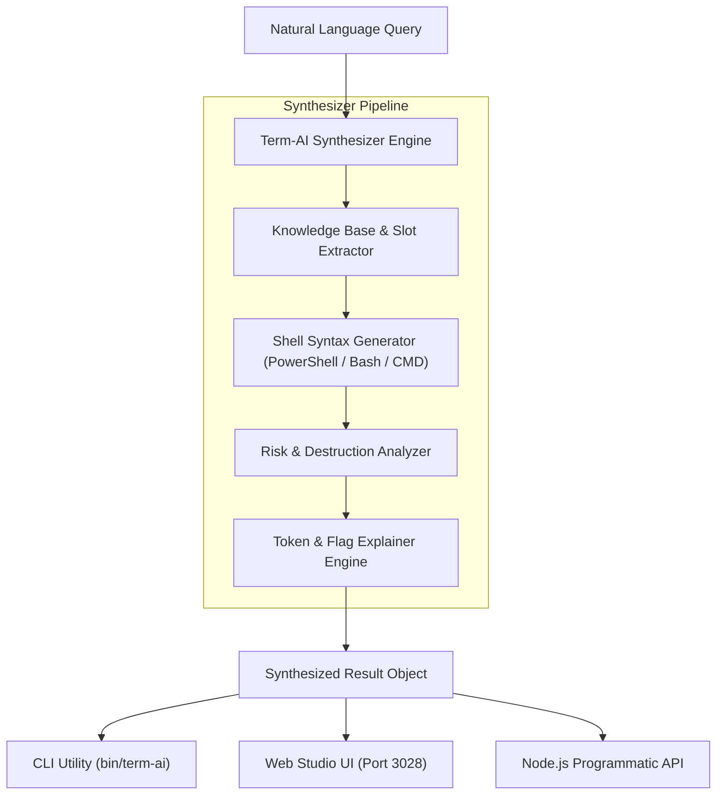

<div align="center">

# ⚡ Term-AI Helper

**Zero-Dependency Natural Language to Shell Synthesizer, Safety Risk Analyzer & Interactive Studio**

[](https://nodejs.org/)
[](LICENSE)
[](package.json)
[](test/)
[](http://localhost:3028)

*A pure, deterministic terminal intelligence engine that translates plain English into cross-platform shell commands (PowerShell, Bash, CMD) with automated risk categorization and flag-by-flag semantic explanations.*

[Quick Start](#-quick-start) • [Features](#-key-features) • [Architecture](#-architecture) • [CLI Commands](#-cli-usage) • [Web Studio](#-web-studio) • [Safety Engine](#-safety--risk-analyzer) • [Node API](#-node-api)

---

</div>

## 🌟 Key Features

- **🛡️ 100% Zero Dependencies**: Engineered entirely with native Node.js core modules (`http`, `fs`, `path`, `url`, `child_process`, `node:test`).
- **🧠 Deterministic Offline Intelligence**: High-speed offline knowledge base with regex slot extraction for Git, Docker, networking, processes, and filesystem operations.
- **🌐 Cross-Platform Syntax Matrix**: Generates equivalent syntaxes for **PowerShell (Windows)**, **Bash / Zsh (Linux & macOS)**, and **Windows CMD**.
- **🚦 Automated Safety & Risk Engine**: Evaluates every generated or provided command against destructive profiles (**SAFE**, **CAUTION**, **DANGEROUS**) to prevent unintended data loss or irreversible resets.
- **🔍 Flag & Token Semantic Explainer**: Deconstructs complex command strings into granular tokens, highlighting exactly what parameters like `-f`, `-r`, `--soft`, or `--prune` do before execution.
- **🖥️ Built-in Web Studio**: Cyber-obsidian responsive dashboard running on **Port 3028** with quick-action chips, cross-platform previews, one-click copy, and real-time risk badges.

---

## 🏗️ Architecture



---

## 🚀 Quick Start

### Local Execution & Testing

```bash
# Clone the repository
git clone https://github.com/mahdyarmonfared/term-ai-helper.git
cd term-ai-helper

# Run the test suite
npm test

# Launch the Web Studio
npm start
# Open http://localhost:3028 in your browser
```

---

## 💻 CLI Usage

The package exposes the `term-ai` executable:

```bash
# Basic query in default shell (PowerShell)
npx term-ai "kill process on port 3000"

# Target specific shell (Bash)
npx term-ai "undo last commit keeping files" --shell bash

# Detailed flag & argument breakdown
npx term-ai "find files larger than 100mb" --explain

# Dangerous command risk check
npx term-ai "undo last commit and discard changes"

# Launch Web Studio
npx term-ai studio --port 3028
```

### CLI Flags & Parameters

| Option | Flag | Description | Default |
| :--- | :--- | :--- | :--- |
| `--shell <type>` | `-s` | Target shell: `pwsh`, `bash`, `cmd` | `pwsh` |
| `--explain` | `-e` | Display token and flag explanations | `false` |
| `--port <num>` | `-p` | Port for Web Studio server | `3028` |
| `--help` | `-h` | Display usage instructions | |

---

## 🚦 Safety & Risk Analyzer

Commands are classified into three distinct safety tiers:

| Tier | Badge | Criteria | Typical Examples |
| :--- | :--- | :--- | :--- |
| **SAFE** | `[SAFE]` | Read-only queries, inspections, status, diagnostic utilities | `git status`, `lsof -i :8080`, `df -h`, `Get-Process` |
| **CAUTION** | `[CAUTION]` | Process termination, state creation, uncommitted alterations | `kill -9`, `Stop-Process`, `git reset --soft`, `docker prune` |
| **DANGEROUS** | `[DANGEROUS]` | Irreversible data loss, disk destruction, tree wiping | `rm -rf /`, `git reset --hard`, `Remove-Item -Recurse -Force` |

---

## 🖥️ Web Studio

Term-AI Helper includes an embedded browser dashboard running on **Port 3028**:

```bash
npm start
# Live at http://localhost:3028
```

### Studio Capabilities
- **Real-Time Shell Switching**: Instant toggle between PowerShell, Bash/Zsh, and CMD.
- **One-Click Action Chips**: Pre-configured queries for port cleanup, git resets, docker hygiene, and SSL inspections.
- **Live Risk Telemetry**: Visual indicator warning before executing destructive terminal commands.
- **Token Tree**: Interactive inspection of all command arguments and flags.

---

## 📦 Node API

Import Term-AI Helper directly into your Node.js scripts or CI/CD pipelines:

```javascript
const { synthesizeCommand, evaluateRisk, explainCommand } = require('term-ai-helper');

// 1. Synthesize Natural Language
const result = synthesizeCommand('kill process on port 3000', { shell: 'pwsh' });
console.log(result.command);
// Stop-Process -Id (Get-NetTCPConnection -LocalPort 3000 -ErrorAction SilentlyContinue).OwningProcess -Force

// 2. Cross-platform alternative
console.log(result.alternatives.bash);
// fuser -k 3000/tcp || lsof -ti:3000 | xargs kill -9

// 3. Risk Profile
console.log(result.risk.level); // 'caution'

// 4. Token Breakdown
console.log(result.breakdown);
```

---

## 🧪 Testing

The comprehensive test suite is built on Node's native runner (`node:test`):

```bash
npm test
```

```text
▶ term-ai-helper - Command Explainer (3 tests passed)
▶ term-ai-helper - Risk Analyzer (6 tests passed)
▶ term-ai-helper - Web Studio Server & API (5 tests passed)
▶ term-ai-helper - Synthesizer Engine (6 tests passed)

ℹ tests 20
ℹ suites 4
ℹ pass 20
ℹ fail 0
```

---

## 📄 License

MIT © [Mahdyar Monfared](https://github.com/mahdyarmonfared)
